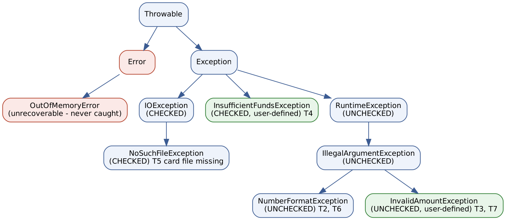
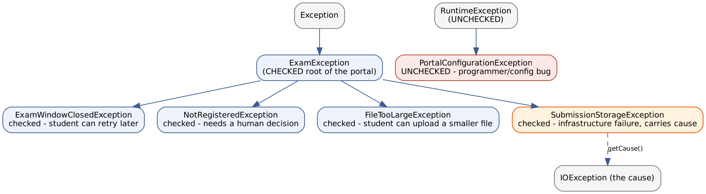
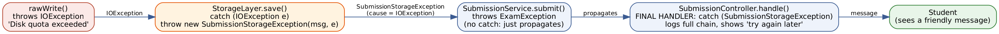
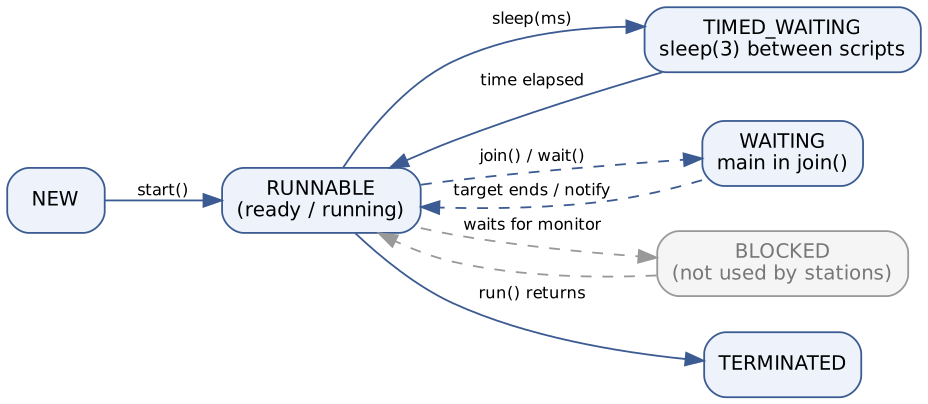
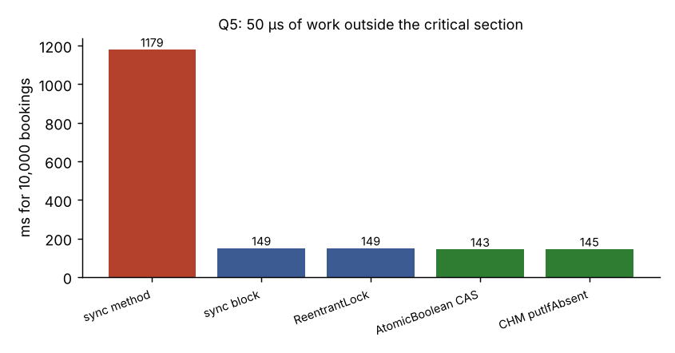
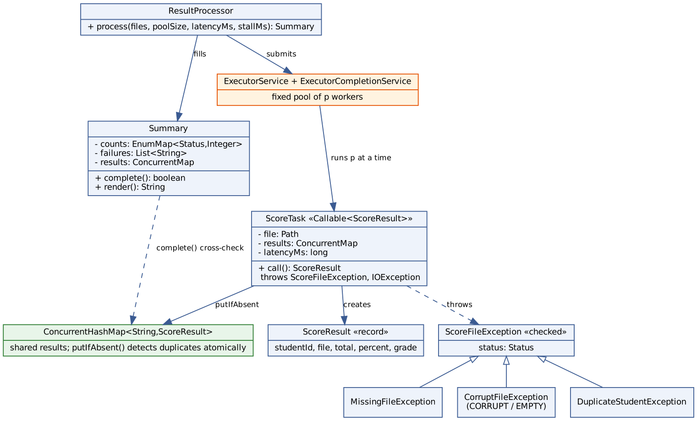
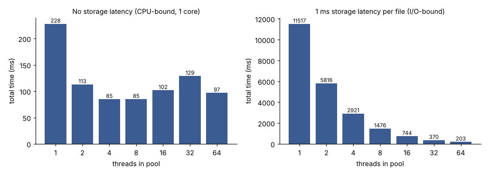

| | Student A | Student B |
|---|---|---|
| Name | T.Achyuth | [partner's name] |
| Register number | 192372257 | [RegNo B] |
| GitHub repository | [link A] | [link B] |

**Course:** CSA09 – Programming in Java  **Java version:** OpenJDK 21 (code needs JDK 17+)  **Mode:** Pair work, 50 marks

**How to read this report.** Each question follows the assignment's structure: *Shared Group Work → Student A → Student B → Joint answer → Complete the Code (where given) → Alternative Concept and Complexity Analysis*. All program output shown here was produced by the code in the repository (`Qn/output/`). The measurements were taken on a single-core virtual machine; **each student must re-run the programs and replace the numbers with their own** (the conclusions do not depend on the exact values, but timings, thread orders and the number of double bookings will differ on other machines).

**Individual Contribution Record** is in the last section of this report.

```{=openxml}
<w:p><w:r><w:br w:type="page"/></w:r></w:p>
```

# Q1 – Handling Failure in a Bank ATM Simulation (6 marks, K4)

## Shared Group Work

**Every point at which a withdrawal can fail, and its classification**

| # | Failure point | What goes wrong | Exception | Category |
|---|---|---|---|---|
| 1 | Reading the card-reader file | File missing / unreadable | `NoSuchFileException` (an `IOException`) | **Checked** – the environment can fail and the caller must decide |
| 2 | Parsing the account number | User types letters (`10O1`) | `NumberFormatException` | **Unchecked** – bad input detectable by validation |
| 3 | Parsing the amount | User types `abc` | `NumberFormatException` | Unchecked |
| 4 | Checking the amount | Zero or negative amount | `InvalidAmountException` (user-defined, extends `IllegalArgumentException`) | Unchecked |
| 5 | Looking up the account | Account does not exist | `InvalidAmountException` | Unchecked |
| 6 | Checking the balance | Amount above balance | `InsufficientFundsException` (user-defined, extends `Exception`) | **Checked** – a normal business outcome the caller must handle |
| 7 | JVM failure | Out of memory, stack overflow | `OutOfMemoryError`, `StackOverflowError` | **Error** – not caught by the ATM; the program cannot sensibly continue |

*Design reasoning:* a condition becomes **checked** when a correct caller can recover from it (try another card, show "insufficient funds") and the compiler should force that decision; it becomes **unchecked** when it signals a caller mistake that validation should prevent. **Errors** are never caught because the JVM itself is in trouble.

**Implementation** (`Q1/AtmWithdrawal.java`, key part):

```java
try {
    double left = withdraw(accText, amtText, card);
    path = "SUCCESS balance left=" + left;
} catch (NoSuchFileException e) {          // narrow IO exception first
    ...
} catch (IOException e) {                  // broader IO exception after it
    ...
} catch (InsufficientFundsException e) {   // checked business exception
    ...
} catch (NumberFormatException | InvalidAmountException e) {  // multi-catch of siblings
    ...
} finally {
    sessionsClosed++;                      // card ejected on EVERY path
}
```

A note found while testing: `Files.newBufferedReader` throws `NoSuchFileException`, **not** `FileNotFoundException` (that is thrown by `FileReader`/`FileInputStream`). Both are subclasses of `IOException`, so the order rule is the same, but catching the wrong one would silently never match.

## Student A – Exception Design

**Throwable hierarchy relevant to the ATM**

{ width=85% }

**Failure point → exception → checked/unchecked → where caught**

| Failure point | Exception type | Checked? | Where it is caught |
|---|---|---|---|
| Card file missing | `NoSuchFileException` | Checked | `attempt()` – first `catch` |
| Letters in account number | `NumberFormatException` | Unchecked | `attempt()` – multi-catch |
| Letters in amount | `NumberFormatException` | Unchecked | `attempt()` – multi-catch |
| Negative / zero amount | `InvalidAmountException` | Unchecked | `attempt()` – multi-catch |
| Unknown account | `InvalidAmountException` | Unchecked | `attempt()` – multi-catch |
| Amount above balance | `InsufficientFundsException` | Checked | `attempt()` – its own `catch` |
| Out of memory | `OutOfMemoryError` | Error | Not caught (program ends) |

**Why the catch blocks are in this order.** Java checks `catch` clauses from top to bottom and runs the *first* one that matches, so a subclass must appear before its superclass. `NoSuchFileException` therefore comes before `IOException`; if the order is reversed the compiler rejects the program (Student B shows the real error). The other three handlers are unrelated types, so their relative order does not matter. The two unchecked exceptions share one multi-catch because they need identical handling and are *siblings* under `IllegalArgumentException`; a multi-catch may not list a class together with its own subclass, which is another reason `NoSuchFileException | IOException` could not have been written.

**What `finally` guarantees here.** The card is ejected (the `sessionsClosed` counter increments) whether the withdrawal succeeds, a caught exception is handled, or an exception escapes unhandled. In the test run it executed **7 times for 7 attempts**. It would not run only if the JVM is killed or `System.exit()` is called inside the `try`.

## Student B – Testing and Tracing

**Test inputs, the path each one took, and whether `finally` ran**

| Test | Input (account, amount) | Intended path | Block that ran | `finally` ran? |
|---|---|---|---|---|
| T1 | 1001, 2000 | Valid withdrawal | none (success, balance left 3000.0) | Yes |
| T2 | 10O1, 500 | Letters in account | `NumberFormatException \| InvalidAmountException` | Yes |
| T3 | 1001, -300 | Negative amount | same multi-catch (`InvalidAmountException`) | Yes |
| T4 | 1001, 9999 | Above balance | `InsufficientFundsException` (short by Rs 6999.0) | Yes |
| T5 | 1001, 500 + missing file | Card file missing | `NoSuchFileException` | Yes |
| T6 | 1001, abc | Letters in amount | multi-catch (`NumberFormatException`) | Yes |
| T7 | 7777, 100 | Unknown account | multi-catch (`InvalidAmountException`) | Yes |

Console output of the run:

```text
=== Q1 ATM test run ===
  [finally: card ejected #1] T1 valid withdrawal | in=(1001,2000) -> SUCCESS balance left=3000.0
  [finally: card ejected #2] T2 letters in account number | in=(10O1,500) -> catch NumberFormatException|InvalidAmountException -> For input string: "10O1"
  [finally: card ejected #3] T3 negative amount | in=(1001,-300) -> catch NumberFormatException|InvalidAmountException -> Amount must be positive: -300.0
  [finally: card ejected #4] T4 amount above balance | in=(1001,9999) -> catch InsufficientFundsException -> Insufficient balance, short by Rs 6999.0
  [finally: card ejected #5] T5 card-reader file missing | in=(1001,500) -> catch NoSuchFileException -> card reader file missing: /nonexistent/cardreader.dat
  [finally: card ejected #6] T6 letters in amount | in=(1001,abc) -> catch NumberFormatException|InvalidAmountException -> For input string: "abc"
  [finally: card ejected #7] T7 unknown account | in=(7777,100) -> catch NumberFormatException|InvalidAmountException -> Unknown account 7777
finally blocks executed: 7 of 7 attempts
```

**Stack trace of an uncaught exception, line by line** (`UncaughtDemo`, input `10O1`):

```text
Starting withdrawal...
Exception in thread "main" java.lang.NumberFormatException: For input string: "10O1"
    at java.base/java.lang.NumberFormatException.forInputString(NumberFormatException.java:67)
    at java.base/java.lang.Long.parseLong(Long.java:709)
    at java.base/java.lang.Long.parseLong(Long.java:832)
    at UncaughtDemo.parseAccount(UncaughtDemo.java:3)
    at UncaughtDemo.withdraw(UncaughtDemo.java:4)
    at UncaughtDemo.main(UncaughtDemo.java:7)
```

| Line | Meaning |
|---|---|
| `Exception in thread "main" java.lang.NumberFormatException: For input string: "10O1"` | The exception type, its message, and the thread that died |
| `at ...NumberFormatException.forInputString(...:67)` | Where the exception object was created (inside the JDK) |
| `at ...Long.parseLong(Long.java:709)` and `:832` | Two JDK frames: one `parseLong` overload calling the other |
| `at UncaughtDemo.parseAccount(UncaughtDemo.java:3)` | **First line of our own code: the real culprit** |
| `at UncaughtDemo.withdraw(UncaughtDemo.java:4)` | Who called `parseAccount` |
| `at UncaughtDemo.main(UncaughtDemo.java:7)` | The bottom frame, where it all started |

Read the trace top to bottom to follow the call stack from the deepest call up to `main`. Because no method catches it, the thread dies and `"never reached"` is never printed.

**Broader catch placed before a narrower one** (`Q1/broken/BrokenCatchOrder.java`). The compiler output is real:

```text
broken/BrokenCatchOrder.java:10: error: exception FileNotFoundException has already been caught
        } catch (FileNotFoundException e) {    // unreachable
          ^
1 error
```

The program does not compile, because the second handler could never run. Java turns this logic error into a compile-time error.

## Joint Design Question – should the ATM use a single `catch (Exception e)`?

It is acceptable only at the **outermost boundary** of the program (for example the top of the ATM loop) as a last-resort safety net that logs the problem and shows a generic message, so that one unexpected bug does not crash the machine. Used instead of specific handlers, it **loses**: (1) the ability to give the customer a useful message ("insufficient balance" versus "card unreadable"); (2) different recovery actions per failure; (3) the distinction between recoverable conditions and programming bugs, since `NullPointerException` or `IndexOutOfBoundsException` would be silently treated like a wrong PIN; (4) the compiler's help, because it also hides any checked exception a later change forgets to handle. The recommended pattern is specific handlers first, one final broad handler that logs the stack trace, and `Error` left alone.

## Alternative Concept and Complexity Analysis – no exceptions, error codes instead

`Q1/ErrorCodeAtm.java` validates every input in advance with `Scanner.hasNextLong()` / `hasNextDouble()` and returns codes (`0` OK, `-1` bad account, `-2` bad amount, `-3` no funds):

```text
=== error-code ATM sample ===
[1001, 2000] -> code 0
[10O1, 500] -> code -1
[1001, -5] -> code -2
[1001, 9999] -> code -3
[1001, abc] -> code -2

```

**Comparison.** The error-code version needs **four explicit checks** in the same method, and *every caller* must remember to test the returned code; forgetting a test silently continues with bad data. The exception version has no checks on the happy path, the checked exception forces the caller to decide, and error handling is separated from the normal logic. Error codes are however faster and allocate nothing.

**Time and space of a failure (measured).** Creating and throwing an exception costs *O(d)* time, where *d* is the stack depth, because the JVM must fill in the stack trace; returning a code costs *O(1)*.

| Stack depth | throw + catch (ns) | return code (ns) | throw, stack trace disabled (ns) |
|---|---|---|---|
| 10 | 887 | 14 | 13 |
| 100 | 4207 | 388 | 360 |
| 500 | 20616 | 2617 | 3326 |

(The depth-100 and depth-500 columns also include the cost of the recursion used to build the depth, which is why the "code" column grows; the *difference* is the exception cost, roughly 60× at depth 10 and 8× at depth 500. The 3326 versus 2617 at depth 500 is measurement noise.) In space, an exception object is *O(d)* (about 728 bytes at depth 10, measured in Q2) versus *O(1)* for an `int`. **Conclusion:** exceptions cost more per failure but failures are rare, so the clarity and safety of exceptions win for an ATM; error codes suit tight loops where failure is the common case.

```{=openxml}
<w:p><w:r><w:br w:type="page"/></w:r></w:p>
```

# Q2 – User-Defined Exceptions and Propagation in an Online Examination Portal (7 marks, K4)

## Shared Group Work

**Design.** One checked root `ExamException` with four checked subclasses, plus one unchecked exception for programmer errors.

| Exception | Checked? | Thrown by | Reason for the choice |
|---|---|---|---|
| `ExamWindowClosedException` | Checked | Service | A normal outcome the student can act on (wait, contact admin); the compiler should force every caller to handle it |
| `NotRegisteredException` | Checked | Service | Needs a human decision; must not be ignored |
| `FileTooLargeException` | Checked | Service | Student can upload a smaller file |
| `SubmissionStorageException` | Checked | Storage | Infrastructure failure that carries the original `IOException` as its cause |
| `PortalConfigurationException` | **Unchecked** | Service constructor | Exam window ends before it starts: a bug or bad configuration, not something callers can recover from |

**Three layers** (`Q2/portal/ExamPortal.java`): `SubmissionController` (final handler) → `SubmissionService` (business rules, declares `throws ExamException`, does not catch) → `StorageLayer` (catches `IOException`, throws `SubmissionStorageException(msg, e)`).

## Student A – Exception Hierarchy and Propagation Design

{ width=90% }

**Why each is checked or unchecked.** The four portal-rule exceptions are *expected, recoverable* failures: the compiler should force every layer to either handle them or declare them, so none can be forgotten. `PortalConfigurationException` signals a programming or configuration error; forcing callers to catch it would clutter the code and nobody could repair it at run time, so it is unchecked.

**Propagation path of one exception (storage failure):**

{ width=100% }

**Where it is finally handled, and what the student sees.** `StorageLayer.rawWrite()` throws an `IOException("Disk quota exceeded...")`; `StorageLayer.save()` catches it and throws a `SubmissionStorageException` that keeps the `IOException` as its cause; `SubmissionService.submit()` does not catch, so it propagates; `SubmissionController.handle()` is the only place that catches it. It logs the full chain for administrators and returns to the student: *"SORRY: your file could not be saved right now. Please try again in a few minutes."* The student never sees internal details such as the quota size.

## Student B – Failure Scenarios and Chaining Evidence

**One scenario for each exception, observed behaviour** (real output):

```text
=== Q2 scenario table ===
S1 normal submission                                -> SUCCESS: ans1.pdf submitted
S2 exam window closed                               -> REJECTED: Exam window 09:00-12:00 is closed at 12:30
S3 student not registered                           -> REJECTED: S9 is not registered for CSA09
S4 file above 200 KB limit                          -> REJECTED: ans4.pdf is 300 KB; limit is 200 KB
   [log for admins] SubmissionStorageException: Could not store ans5.pdf for S2  <-caused by-  IOException: Disk quota exceeded (150 KB > 100 KB)
S5 storage failure (quota forced to 100 KB below)   -> SORRY: your file could not be saved right now. Please try again in a few minutes.
```

| Scenario | Exception raised | Message the student sees | Cause present? |
|---|---|---|---|
| S1 normal submission | none | SUCCESS | – |
| S2 submit at 12:30, window 09:00–12:00 | `ExamWindowClosedException` | REJECTED: Exam window ... is closed at 12:30 | No |
| S3 student S9 not registered | `NotRegisteredException` | REJECTED: S9 is not registered for CSA09 | No |
| S4 300 KB file, limit 200 KB | `FileTooLargeException` | REJECTED: ans4.pdf is 300 KB; limit is 200 KB | No |
| S5 disk quota exceeded | `SubmissionStorageException` | SORRY: ... try again in a few minutes | **Yes – `IOException`** |
| Config error | `PortalConfigurationException` | (unchecked) Exam window closes before it opens | No |

**Chained stack trace with `getCause()`** (cause preserved):

```text
=== Q2 scenario table ===
S1 normal submission                                -> SUCCESS: ans1.pdf submitted
S2 exam window closed                               -> REJECTED: Exam window 09:00-12:00 is closed at 12:30
S3 student not registered                           -> REJECTED: S9 is not registered for CSA09
S4 file above 200 KB limit                          -> REJECTED: ans4.pdf is 300 KB; limit is 200 KB
   [log for admins] SubmissionStorageException: Could not store ans5.pdf for S2  <-caused by-  IOException: Disk quota exceeded (150 KB > 100 KB)
S5 storage failure (quota forced to 100 KB below)   -> SORRY: your file could not be saved right now. Please try again in a few minutes.

=== Unchecked configuration error (programmer bug) ===
PortalConfigurationException (unchecked): Exam window closes before it opens

=== Chained stack trace (cause preserved) ===
SubmissionStorageException: Could not store ans5.pdf for S2
    at StorageLayer.save(ExamPortal.java:35)
    at ExamPortal.main(ExamPortal.java:137)
Caused by: java.io.IOException: Disk quota exceeded (150 KB > 100 KB)
    at StorageLayer.rawWrite(ExamPortal.java:47)
    at StorageLayer.save(ExamPortal.java:33)
    ... 1 more
getCause() = java.io.IOException: Disk quota exceeded (150 KB > 100 KB)
frames in wrapper trace = 2, frames in cause trace = 3

=== Same failure, cause DROPPED ===
SubmissionStorageException: Could not store ans5.pdf for S2
    at StorageLayer.saveLossy(ExamPortal.java:43)
    at ExamPortal.main(ExamPortal.java:146)
getCause() = null   <- the quota reason and the original line number are lost
```

The trace shows `Caused by: java.io.IOException: Disk quota exceeded (150 KB > 100 KB)` with the original line (`rawWrite`, line 47). `getCause()` returns that `IOException`.

**What is lost when the cause is dropped** (`saveLossy`, last block of the same output): the trace contains only the wrapper's own frames, `getCause()` is `null`, and both the reason (*quota exceeded, 150 KB > 100 KB*) and the line where the real failure happened are gone. A maintainer sees "Could not store ans5.pdf" and has no way to find out why.

## Joint Conclusion – why wrap `IOException` in `SubmissionStorageException`?

The user-interface layer should not know that storage uses files; tomorrow it may use a database or cloud storage, and then every layer above would have to change its `catch (IOException)`. A meaningful `SubmissionStorageException` **hides the implementation detail** (abstraction), gives the controller one stable exception to handle, carries a message in portal terms, and – because of chaining – still preserves the original `IOException` for diagnosis. Letting a raw `IOException` reach the UI would either show a confusing technical message to the student or force the UI to understand the storage layer.

## Complete the Code – `StorageDemo` (TODO 1)

Completed line (nothing else in the program was changed):

```java
} catch (IOException e) {
    throw new SubmissionStorageException("Could not store " + fileName, e);
}
```

Output (identical to the expected output):

```text
Saved answer01.pdf
Error: Could not store answer02.pdf
Cause: Disk quota exceeded
```

**What prints in the `Cause:` line if the `IOException` is not passed to the constructor?** `getCause()` returns `null`, so `e.getCause().getMessage()` itself throws a `NullPointerException` and the `Cause:` line is never printed. Real output of `StorageDemoNoCause` (cause replaced by `null`):

```text
Saved answer01.pdf
Error: Could not store answer02.pdf
Exception in thread "main" java.lang.NullPointerException: Cannot invoke "java.lang.Throwable.getMessage()" because the return value of "ExamException.getCause()" is null
    at StorageDemoNoCause.main(StorageDemoNoCause.java:34)
```

## Alternative Concept and Complexity Analysis – unchecked custom exceptions

If `ExamException` extended `RuntimeException`: method signatures lose their `throws ExamException` clauses; callers are no longer forced to catch, so the code is shorter, but a forgotten handler is found only at run time (the exception would travel up to the thread's default handler and kill the request). Lambdas and streams become easier to use, because checked exceptions cannot cross them.

**Cost of capturing a stack trace (measured, `ExceptionCostBench`)**

| Stack depth | Kind | ns per creation | Bytes per exception |
|---|---|---|---|
| 10 | checked | 940 | 728 |
| 10 | unchecked | 858 | 728 |
| 10 | checked + chained cause | 2000 | 1456 |
| 10 | no stack trace | 12 | 40 |
| 100 | checked | 4353 | 2792 |
| 100 | unchecked | 5133 | 2792 |
| 100 | checked + chained cause | 7999 | 5584 |
| 1000 | checked | 40053 | 22056 |
| 1000 | checked + chained cause | 60234 | 44112 |

**Analysis.** Capturing a stack trace is *O(d)* in time and space for stack depth *d*. **Checked and unchecked cost the same at run time** (the difference is only a compile-time rule). A chained exception holds *two* traces, so its memory is *O(d₁ + d₂)* – about double in the measurements (1456 versus 728 bytes) – and the cause object stays reachable as long as the wrapper does, so long-lived references to exceptions (for example stored in a cache) keep both traces alive. Disabling the stack trace removes the cost but also removes the diagnostic value.

```{=openxml}
<w:p><w:r><w:br w:type="page"/></w:r></w:p>
```

# Q3 – Resource Safety, Debugging and Robust Code (7 marks, K4)

## Shared Group Work

Four versions of the sales-report generator were written (`Q3/SalesReport.java`); all read store files of lines `item,qty,price` and write a summary:

| Version | How files are closed |
|---|---|
| V0 | Never closed (baseline for "no closing at all") |
| V1 | Manual `close()` placed at the end of the `try` (the retail chain's version) |
| V2 | Manual `close()` inside `finally` (correct but verbose) |
| V3 | try-with-resources |

**Verification that the versions produce the same report** (40 valid store files):

```text
=== A. Same input (40 valid stores), is the report identical? ===
V0 no close()                  identical=true   total line: TOTAL,323320.00
V1 manual close() in try       identical=true   total line: TOTAL,323320.00
V2 manual close() in finally   identical=true   total line: TOTAL,323320.00
V3 try-with-resources          identical=true   total line: TOTAL,323320.00
```

All four produce a byte-identical report (`identical=true`, total 323320.00).

## Student A – Debugging and Experimental Analysis

**Locating the leak with a debugger.** The failing input is a store file whose line 101 has `x` instead of a quantity. A breakpoint was set on `double v = parseStore(r);` in the V1 loop, and the real command-line debugger (`jdb`) was used to step. At the breakpoint for `store003.csv` the reader is open (`TrackedReader.OPEN = 1`); a `next` (step over) does **not** go to the following line 88 (`r.close()`) but jumps straight to line 91, the `catch` block. That is the leak: `close()` on line 88 was skipped and the reader stays open (`OPEN` is still 1).

```text
Initializing jdb ...
Deferring breakpoint SalesReport$ManualHappyPath:87.
It will be set after the class is loaded.
run Dbg
Set uncaught java.lang.Throwable
Set deferred uncaught java.lang.Throwable
VM Started: Set deferred breakpoint SalesReport$ManualHappyPath:87
Breakpoint hit: "thread=main", SalesReport$ManualHappyPath.run(), line=87 bci=46
main[1]  s = "/tmp/dbg3517859882175421084/store001.csv"
main[1]  TrackedReader.OPEN = "1"
main[1] >
Breakpoint hit: "thread=main", SalesReport$ManualHappyPath.run(), line=87 bci=46
main[1]  s = "/tmp/dbg3517859882175421084/store002.csv"
main[1]  TrackedReader.OPEN = "1"
main[1] >
Breakpoint hit: "thread=main", SalesReport$ManualHappyPath.run(), line=87 bci=46
main[1]  s = "/tmp/dbg3517859882175421084/store003.csv"
main[1]  TrackedReader.OPEN = "1"
main[1] >
Step completed: "thread=main", SalesReport$ManualHappyPath.run(), line=91 bci=90
main[1]  TrackedReader.OPEN = "1"
main[1] >    LOG WARNING store failed: store003.cs
```

(The `LOG WARNING` text is the program's own output interleaved with the debugger's.) In an IDE, set the same breakpoint, add `TrackedReader.OPEN` to the Watch window, and take a screenshot at both stops.

**Files left open after the same failing input** (50 store files, every 5th corrupt mid-file → 10 bad files). The tracker counts readers still open; the operating-system column counts real file descriptors (`/proc/self/fd`):

| Version | Files opened | **Still open** (tracker) | OS descriptors left open | After `System.gc()` |
|---|---|---|---|---|
| V0 no close | 50 | **50** | 50 | 0 |
| V1 manual close in `try` | 50 | **10** | 10 | 0 |
| V2 manual close in `finally` | 50 | **0** | 0 | 0 |
| V3 try-with-resources | 50 | **0** | 0 | 0 |

V1 leaks exactly one reader per failing file. The "after GC" column shows the JVM eventually reclaims abandoned file descriptors, but *when* is up to the garbage collector – not a safe design.

**Reproducing the real "Too many open files" error.** With the limit lowered to 100 descriptors, the version that never closes dies at the 95th store while try-with-resources processes all 400 files with the same limit:

```text
ulimit -n = 100
-- V0 (never closes): first failure and final summary
   LOG WARNING store failed: store095.csv -> java.nio.file.FileSystemException: /tmp/fd15947419863674098456/store095.csv: Too many open files
V0 no close(): processed 94 stores, failed 306
-- V3 (try-with-resources), same limit
V3 try-with-resources: processed 400 stores, failed 0
number of stores that failed with "Too many open files": 306
```

**Logging that records which file failed.** `java.util.logging` writes one line per failure with the file name:

```
LOG WARNING store failed: store005.csv -> java.lang.NumberFormatException: For input string: "x"
LOG WARNING store failed: store010.csv -> java.lang.NumberFormatException: For input string: "x"
```

## Student B – Design and Correctness

**Resources and where each must be closed.** (1) One `BufferedReader` per store file – closed immediately after that store is processed, before the next is opened; (2) the summary writer (if streamed) – closed after the last row; the `TrackedReader` wrapper closes the underlying file stream too, so closing the outermost reader is enough.

**Why the manual version can leak.** Closing is an ordinary statement placed after the work. When `parseStore` throws, execution jumps to the `catch` block and the `close()` line is never reached. The reader object is abandoned with its operating-system file descriptor still open; after enough failures the process runs out of descriptors, which is exactly "Too many open files".

**How try-with-resources guarantees closing, and the order.** The compiler expands it into a `try`/`finally` that calls `close()` on every initialised resource whether the body completes normally or throws. Resources are closed in the **reverse** order of declaration, because a later resource may depend on an earlier one. Output of `SuppressedDemo`:

```text
--- 1. Closing order (declared r1, r2, r3) ---
  open  r1
  open  r2
  open  r3
  body runs
  close r3
  close r2
  close r1
--- 2. try-with-resources: body fails AND two closes fail ---
  open  A
  open  B
  close B
  close A
  primary   : body failed
  suppressed: close failed: B
  suppressed: close failed: A
--- 3. manual finally: body fails AND close fails -> original is LOST ---
  open  M
  caught    : body failed
  close M
  finally threw: close failed: M
--- 3b. same code without the inner try: exception from finally REPLACES the body exception ---
  open  M2
  close M2
  caller sees: close failed: M2  (suppressed count = 0)
```

(`r3, r2, r1` – the reverse of `r1, r2, r3`.)

**Suppressed exceptions.** If the body throws *and* `close()` also throws, try-with-resources keeps the **body's** exception as the primary one and attaches the close failures to it as *suppressed* exceptions (`getSuppressed()`; case 2 shows `body failed` as primary with `close failed: B` and `close failed: A` suppressed). In a hand-written `finally`, the exception thrown by `close()` **replaces** the original one and the real cause is lost (case 3b: the caller sees only `close failed: M2`). This is a second reason to prefer try-with-resources.

## Joint Engineering Decision – when is try-with-resources not sufficient by itself?

It closes resources, but robustness needs more when: (1) **`close()` itself can lose data** – a writer's final flush may fail, and that failure must be reported, not ignored; (2) **the output must be all-or-nothing** – closing a half-written summary leaves an *incomplete report* on disk, which is the second symptom described in the problem; the fix is to write to a temporary file and `Files.move(..., ATOMIC_MOVE)` it only on success (a design recommendation; it is not implemented in this assignment's code); (3) a resource is **not `AutoCloseable`** (a lock that must be unlocked, a transaction that must be rolled back) and still needs `finally`; (4) the **design opens too many files at once** (for example all store files before processing) – scoping each one tightly keeps the peak low; (5) a **failure policy** is still needed: skip and log, or abort – and the log must say which file failed.

## Alternative Concept and Complexity Analysis

If `finally` with explicit `close()` (V2), or no closing at all (V0), were used instead of try-with-resources:

* **Time.** For *f* store files with *L* lines in total, every version does *O(L)* work. Measured medians (ms) for valid files confirm no systematic difference:

```text
=== A. Same input (40 valid stores), is the report identical? ===
V0 no close()                  identical=true   total line: TOTAL,323320.00
V1 manual close() in try       identical=true   total line: TOTAL,323320.00
V2 manual close() in finally   identical=true   total line: TOTAL,323320.00
V3 try-with-resources          identical=true   total line: TOTAL,323320.00

=== B. Failing input: 50 stores, every 5th corrupt mid-file (10 bad files) ===
version                          opened   still open    OS fd delta       after GC report matches V3
   LOG WARNING store failed: store005.csv -> java.lang.NumberFormatException: For input string: "x"
   LOG WARNING store failed: store010.csv -> java.lang.NumberFormatException: For input string: "x"
   LOG WARNING store failed: store015.csv -> java.lang.NumberFormatException: For input string: "x"
   LOG WARNING store failed: store020.csv -> java.lang.NumberFormatException: For input string: "x"
   LOG WARNING store failed: store025.csv -> java.lang.NumberFormatException: For input string: "x"
   LOG WARNING store failed: store030.csv -> java.lang.NumberFormatException: For input string: "x"
   LOG WARNING store failed: store035.csv -> java.lang.NumberFormatException: For input string: "x"
   LOG WARNING store failed: store040.csv -> java.lang.NumberFormatException: For input string: "x"
   LOG WARNING store failed: store045.csv -> java.lang.NumberFormatException: For input string: "x"
   LOG WARNING store failed: store050.csv -> java.lang.NumberFormatException: For input string: "x"
   (V3 log lines above are expected: one WARNING per corrupt store)
V0 no close()                        50           50             50              0 true
V1 manual close() in try             50           10             10              0 true
V2 manual close() in finally         50            0              0              0 true
V3 try-with-resources                50            0              0              0 true

=== C. Logging output of V3 on the failing input (first 3 shown) ===
   LOG WARNING store failed: store005.csv -> java.lang.NumberFormatException: For input string: "x"
   LOG WARNING store failed: store010.csv -> java.lang.NumberFormatException: For input string: "x"
   LOG WARNING store failed: store015.csv -> java.lang.NumberFormatException: For input string: "x"
   ... (10 warnings in total, one per corrupt store)

=== D. Median processing time (ms, 5 runs) for f valid store files of 200 lines ===
f            V2 finally         V3 TWR
100                 6.8            4.2
200                15.4           15.3
400                27.5           26.2
800                25.3           23.2
```

  | f | V2 `finally` | V3 try-with-resources |
  |---|---|---|
  | 100 | 6.8 | 4.2 |
  | 200 | 15.4 | 15.3 |
  | 400 | 27.5 | 26.2 |
  | 800 | 25.3 | 23.2 |

  (Small values are dominated by JIT warm-up and caching, which is why 800 files is not slower than 400; the point is that V2 and V3 are the same order.)
* **Space – file handles held open when failures occur.** V3 and V2: at most **1** (*O(1)*), always released. V1: **one leaked per failing file** (*O(m)*, 10 in the experiment). V0: **all** (*O(f)*, 50 in the experiment, and the process died at the 95th file when the limit was 100).

```{=openxml}
<w:p><w:r><w:br w:type="page"/></w:r></w:p>
```

# Q4 – Thread Creation and the Thread Life Cycle (7 marks, K4)

## Shared Group Work

Four scanner stations (`Q4/ScanStations.java`) were written twice: `StationThread extends Thread` and `StationTask implements Runnable` (run through `new Thread(task, name)`); each station "scans" 40 scripts, sleeping 3 ms per script, and adds to a shared `AtomicInteger` total. `start()`, `sleep()`, `join()` and `isAlive()` are all used:

```text
=== 1. extends Thread ===
  isAlive right after start(): S1=true S2=true S3=true S4=true
  isAlive after join()      : S1=false S2=false S3=false S4=false
  finish order = [S1, S2, S4, S3], total scanned = 160 (expected 160)
=== 2. implements Runnable ===
  isAlive right after start(): S1=true S2=true S3=true S4=true
  isAlive after join()      : S1=false S2=false S3=false S4=false
  finish order = [S1, S3, S2, S4], total scanned = 160 (expected 160)
=== 3. run() vs start(): which thread executes the body? ===
```

`isAlive()` is true right after `start()` and false after `join()`; the total is 160 (4 × 40) in both versions, so no scan was lost.

## Student A – Thread Design

**Two ways to create a thread.** *Extending `Thread`* ties the work to the thread object and uses up the single inheritance slot. *Implementing `Runnable`* separates the **task** (what to do) from the **thread** (how to run it), lets the class extend something else, and lets the same task object be given to a thread, an executor, or a lambda. Prefer `Runnable` (or `Callable`) in almost every real program; extend `Thread` only to change thread behaviour itself.

**Life-cycle diagram** (the states a station passes through are marked: NEW → RUNNABLE ⇄ TIMED_WAITING → TERMINATED; `main` itself is WAITING inside `join()`):

{ width=100% }

**Observed states** (`getState()` output of the same program):

```text
=== 1. extends Thread ===
  isAlive right after start(): S1=true S2=true S3=true S4=true
  isAlive after join()      : S1=false S2=false S3=false S4=false
  finish order = [S1, S2, S4, S3], total scanned = 160 (expected 160)
=== 2. implements Runnable ===
  isAlive right after start(): S1=true S2=true S3=true S4=true
  isAlive after join()      : S1=false S2=false S3=false S4=false
  finish order = [S1, S3, S2, S4], total scanned = 160 (expected 160)
=== 3. run() vs start(): which thread executes the body? ===
  calling t.run()   ->   body executed by thread: main
  calling t.start() ->   body executed by thread: worker-1
  calling t.start() a second time:
  java.lang.IllegalThreadStateException
=== 4. Thread life-cycle states observed with getState() ===
  sleeper before start : NEW
  sleeper              : TIMED_WAITING   (Thread.sleep)
  waiter-on-join       : WAITING         (join without timeout)
  blocked-on-lock      : BLOCKED         (waiting for monitor)
  spinner              : RUNNABLE        (running / ready)
  sleeper after finish : TERMINATED
```

**Why `run()` is not `start()`.** The output shows it directly: calling `t.run()` executed the body in thread **`main`**, while `t.start()` executed it in **`worker-1`**. `start()` asks the JVM to create a new call stack and schedule the thread; `run()` is an ordinary method call on the current thread, so nothing runs in parallel. Calling `start()` twice throws `IllegalThreadStateException` (a thread can be started only once).

**Why `join()` makes the total correct.** `main` calls `t.join()` on each station; `join()` moves `main` to WAITING until that thread is TERMINATED. Only after all four joins return does `main` read the total and print it, so the total cannot be printed too early.

## Student B – Behavioural Experiments

**Finish order over 12 separate runs** (equal batches of 40 scripts; each line is a new JVM):

```text
--- default priorities ---
run  1: [S1, S3, S2, S4]
run  2: [S2, S1, S4, S3]
run  3: [S2, S1, S4, S3]
run  4: [S2, S1, S4, S3]
run  5: [S2, S4, S1, S3]
run  6: [S3, S1, S4, S2]
run  7: [S4, S3, S1, S2]
run  8: [S3, S2, S1, S4]
run  9: [S3, S4, S1, S2]
run 10: [S2, S3, S1, S4]
run 11: [S1, S2, S4, S3]
run 12: [S1, S4, S2, S3]
```

**Ten different orders appeared in 12 runs** (only runs 2–4 were identical). By contrast, with *unequal* batches (40, 42, 38, 41 scripts, a 6 ms to 12 ms difference per station) the order was the same in all 24 runs (`output/order_runs_unequal_batches.txt`: always S3, S1, S4, S2). The order is therefore not "random": it is decided by how close the stations' workloads are compared with scheduler and timer jitter.

**Priorities.** Station S1 was given `MIN_PRIORITY` and S2 `MAX_PRIORITY`. Counting which station finished *first* over 100 trials (index 0 = S1 … 3 = S4):

```text
Station finishing FIRST, out of 100 trials (S1=MIN, S2=MAX when priorities are set)
default priorities : [24, 31, 21, 24]   (index 0 = S1 ... index 3 = S4)
S1=MIN, S2=MAX     : [23, 23, 29, 25]
```

S2's wins did not rise meaningfully (31 → 23, within noise), and S1's did not fall. **Priority had no measurable effect.** Priorities are hints; the stations spend nearly all their time sleeping, so the scheduler rarely has to choose between them, and the operating system is free to ignore the hint.

**Daemon thread.** S4 got a long batch (5 × 200 ms) and `main` ended after 500 ms:

```text
-- S4 is a normal (user) thread:
  S4 scanned batch 1/5
  S4 scanned batch 2/5
main ends (S4 daemon=false, S4 alive=true)
  S4 scanned batch 3/5
  S4 scanned batch 4/5
  S4 scanned batch 5/5
  S4 finished all batches
-- S4 is a daemon thread:
  S4 scanned batch 1/5
  S4 scanned batch 2/5
main ends (S4 daemon=true, S4 alive=true)
```

As a normal (user) thread S4 kept the JVM alive and finished all batches after `main` had ended. As a **daemon** thread it was **killed the moment `main` finished** – its remaining batches were never scanned. Daemon threads suit background helpers (monitoring, housekeeping) that must not keep the program alive, not work that must complete.

**Explanation using the scheduler.** The operating-system scheduler decides which ready thread runs and for how long; `sleep(3)` wakes up *at least* 3 ms later, by a different amount each time; thread start-up delay and other processes add more jitter. Equal batches therefore finish in an order that varies run to run, whereas batches that differ by more than the jitter finish in a stable order.

## Joint Conclusion – why must a correct program not depend on the order?

The order depends on timing the program does not control (scheduler, load, JVM, hardware). A program whose correctness depends on one order will work in testing and fail in production. The Q4 total is correct for *every* order because it relies on `join()` and an atomic counter, never on who finishes first. If an order really is required it must be enforced explicitly (`join()`, locks, queues), not hoped for.

## Alternative Concept and Complexity Analysis – `ExecutorService` with a fixed thread pool

Instead of creating a `Thread` per station, tasks are submitted to `Executors.newFixedThreadPool(p)`; the pool owns *p* reusable worker threads and queues extra tasks. For *n* = 400 scripts of 3 ms each (`PoolCompare`), *p* threads, ideal time = (*n*/*p*) × 3 ms:

```text
n = 400 scripts, 3 ms each. Ideal time = n/p * 3 ms
p      ideal (ms)    raw threads       fixed pool
1            1200         1251.5           1274.1
2             600          630.2            631.0
4             300          312.5            313.8
8             150          158.0            157.8

Cost of creating threads vs reusing pool workers (1000 tiny tasks, no sleep):
  1000 new Thread objects : 70.4 ms
  1000 tasks on 4 workers : 2.6 ms
```

**Time.** Completion time is about ⌈*n*/*p*⌉ × *t*: *O(n/p)* – both approaches are within about 4 % of the ideal (e.g. p = 4: ideal 300 ms, raw threads 312.5 ms, pool 313.8 ms). **Thread creation cost:** 1000 `new Thread` + `start()` took **70.4 ms**, while 1000 tasks reused by 4 pool workers took **2.6 ms** (about 27× less), because creating an operating-system thread is expensive and the pool pays it only *p* times. **Space.** Each thread has its own stack (default 1024 KB, the `ThreadStackSize` flag, reserved as virtual memory): the pool uses *p* × 1 MB regardless of *n*; creating one thread per task would use *n* × 1 MB. The pool also gives `Future` results, orderly shutdown and a bounded number of threads, which raw threads do not.

```{=openxml}
<w:p><w:r><w:br w:type="page"/></w:r></w:p>
```

# Q5 – Race Conditions in a Cinema Seat-Booking System (6 marks, K4)

## Shared Group Work

Three versions were implemented (`Q5/Bookers.java`, `Q5/complete_code/SeatBooking.java`): **unsynchronized**, **`synchronized` method**, and **`synchronized` block**. The graded program with TODO 1 completed:

```java
synchronized void book(int seat) {
    if (!booked[seat]) {          // check ...
        booked[seat] = true;      // ... then act
        bookingsMade++;           // and count: all one atomic unit
    }
}
```

`RaceTest` verifies that the synchronized versions never double-book (100 threads, 10 seats, 100 runs each, all threads released at the same instant by a `CountDownLatch`):

```text
=== Race reproduction: 100 threads compete for 10 seats, 100 runs each ===
unsynchronized, no latch gap       runs=100  runs with double booking=  0  avg double-booked seats/run=0.00  max 'sold'=10 (valid max 10)
unsynchronized + yield in window   runs=100  runs with double booking= 65  avg double-booked seats/run=0.76  max 'sold'=14 (valid max 10)
synchronized method + yield        runs=100  runs with double booking=  0  avg double-booked seats/run=0.00  max 'sold'=10 (valid max 10)
synchronized block  + yield        runs=100  runs with double booking=  0  avg double-booked seats/run=0.00  max 'sold'=10 (valid max 10)
```

## Student A – Producing and Explaining the Race

**A test that reliably reproduces double booking.** The given `main` rarely fails on its own. With the `synchronized` keyword removed, all 10 runs of the given program printed `Seats sold: 10` (see below) – the race window is a few nanoseconds and each thread finishes before the next starts. `RaceTest` makes the bug appear by (a) releasing all 100 threads together with a latch and (b) calling `Thread.yield()` between the check and the update. With that, **65 of 100 runs double-booked at least one seat** (average 0.76 seats per run; up to 14 "sales" for 10 seats). Both synchronized versions: **0 of 100**. (The exact count changes from run to run, 73 on a second run; the zero for synchronized never did.)

**The race, step by step** (two users, same seat 3, `booked[3] = false`):

| Step | Thread T1 | Thread T2 |
|---|---|---|
| 1 | reads `booked[3]` → false (seat free) | |
| 2 | | reads `booked[3]` → false (still free) |
| 3 | sets `booked[3] = true`, `bookingsMade++` | |
| 4 | | sets `booked[3] = true`, `bookingsMade++` |
| result | **both believe they bought seat 3**; `bookingsMade` counted twice | |

`bookingsMade++` is also a read-modify-write of three steps, so updates can be lost too.

**Critical section.** The three statements `if (!booked[seat]) { booked[seat] = true; bookingsMade++; }` – the check, the change and the counter update must happen as one indivisible unit.

**Complete the Code – results over 10 runs.**

```text
=== UNSYNCHRONIZED SeatBooking, 10 runs ===
run  1: Seats sold: 10
run  2: Seats sold: 10
run  3: Seats sold: 10
run  4: Seats sold: 10
run  5: Seats sold: 10
run  6: Seats sold: 10
run  7: Seats sold: 10
run  8: Seats sold: 10
run  9: Seats sold: 10
run 10: Seats sold: 10
=== SYNCHRONIZED SeatBooking (TODO 1 completed), 10 runs ===
run  1: Seats sold: 10
run  2: Seats sold: 10
run  3: Seats sold: 10
run  4: Seats sold: 10
run  5: Seats sold: 10
run  6: Seats sold: 10
run  7: Seats sold: 10
run  8: Seats sold: 10
run  9: Seats sold: 10
run 10: Seats sold: 10
```

Explanation of why the unsynchronized version *may* sell more than 10: two threads can both pass the `if (!booked[seat])` test before either sets the flag (steps 1–2 above), so the same seat is sold twice and `bookingsMade` exceeds 10. In these 10 runs it did not happen because of timing, not because the code is safe.

## Student B – Comparing Synchronization Strategies

**Time for 10,000 bookings** (8 threads, 1,000 seats, median of 5 runs):

```text
10,000 booking attempts, 8 threads, 1,000 seats; median of 5 runs (ms)
strategy                         prep=0 (pure lock)  prep=50us outside CS*
synchronized method                             1.2                 1179.2
synchronized block                              0.7                  149.4
ReentrantLock                                   1.1                  149.4
AtomicBoolean[] CAS                             0.6                  143.1
ConcurrentHashMap.putIfAbsent                   2.3                  144.8
* 'prep' = simulated payment validation that does not touch shared seat data. The synchronized METHOD must hold the lock during it.
```

{ width=70% }

* With **no other work**, all strategies take 0.6–2.3 ms – the lock is held for a few nanoseconds, so the choice makes no measurable difference (and on this machine there is only one core).
* When each booking also does **50 µs of work that does not touch the seat data** (payment validation, price calculation), locking the **whole method takes 1179 ms; locking only the critical section takes 149 ms, nearly 8× faster.** The method version holds the lock during the validation, so the 8 threads queue one behind another; the block version lets the validations overlap. **Lock the smallest region that must be atomic.**

**Static synchronization – when needed.** A `synchronized` *instance* method locks `this`: each screen object has its own lock, so different screens do not exclude each other. That is correct for each screen's seats, but a counter shared by **all** screens (for example *total tickets sold in the cinema*) is `static`, and an instance lock does not protect it. `StaticSyncDemo` (20 screens, 500 bookings each):

```text
instance lock only (per screen)      : total = 508 (expected 10000)
static (class) lock on shared counter : total = 10000 (expected 10000)
holdsLock(screen) inside synchronized(this)  = true
holdsLock(Screen.class) inside class lock       = true
holdsLock(screen) outside any lock              = false
```

With instance locks only, the shared total was **508 instead of 10,000** (lost updates); with a `static synchronized` method (lock = the `Class` object) it is exactly 10,000.

**Intrinsic locks.** Every Java object has one built-in lock (monitor). A `synchronized` instance method locks `this`; a `synchronized(obj)` block locks `obj` (here also `this`, so the two versions exclude each other); a `static synchronized` method locks the `Class` object. `Thread.holdsLock()` confirms it in the output above (`true` inside the matching block, `false` outside).

## Joint Engineering Decision – which strategy for 20 screens?

**Use one booking object per screen with its own lock (so the 20 screens never block each other), lock only the check-and-update (a small `synchronized` block or method), do slow work such as payment outside the lock, and keep any cinema-wide total in an `AtomicInteger`/`LongAdder` rather than a `static synchronized` method** (a class lock would make all 20 screens queue behind one lock). Reasons: it is simple and provably correct, costs nothing when uncontended, and the measurements show the real danger is holding a lock during slow work, not the choice between `synchronized` and `ReentrantLock`. If one very popular screen shows heavy contention, move that screen to per-seat compare-and-set (`AtomicBoolean[]`), which needs no lock at all. Caveat: our timings are from a single-core machine, so *contention scaling* should be re-measured on a multi-core computer before the final decision.

## Alternative Concept and Complexity Analysis

`AtomicBoolean[]` with `compareAndSet(false, true)`, `ReentrantLock`, and `ConcurrentHashMap.putIfAbsent` were all implemented (`Bookers.java`). The booking is: *CAS*: `booked[seat].compareAndSet(false, true)`; *lock*: `lock(); try { check and set } finally { unlock(); }`; *map*: `map.putIfAbsent(seat, TRUE) == null`.

| Approach | Time per booking | Measured (10,000 bookings, ms, no prep / with 50 µs prep) | Extra space for *s* seats (measured, *s* = 10,000) |
|---|---|---|---|
| `synchronized` method | O(1) uncontended; threads queue under contention | 1.2 / 1179.2 | `boolean[s]`: 10,016 bytes (1.0 B/seat) |
| `synchronized` block | O(1); queue only for the critical section | 0.7 / 149.4 | same: 1.0 B/seat |
| `ReentrantLock` | O(1); queue only for the critical section | 1.1 / 149.4 | + one lock object |
| `AtomicBoolean[]` CAS | O(1) lock-free; a failed CAS retries (rare here) | 0.6 / 143.1 | **203,560 bytes (20.4 B/seat)** – an object per seat |
| `ConcurrentHashMap` | O(1) average | 2.3 / 144.8 | **610,048 bytes (61.0 B/seat)** |

**Analysis.** Under contention the lock-based versions serialize only the critical section, CAS never blocks (it retries), and the map adds hashing. All are *O(1)* per booking, so the real differences are (a) how long the lock is held and (b) memory: CAS costs about 20× and the map about 60× the memory of a `boolean[]` – irrelevant for 200 seats but noticeable for millions.

```{=openxml}
<w:p><w:r><w:br w:type="page"/></w:r></w:p>
```

# Q6 – Deadlock and Inter-Thread Communication (7 marks, K4)

## Shared Group Work

**Part A – wallet transfers** (`Q6/partA/Transfers.java`): a transfer locks the source account and then the destination. **Part B – mess token counter** (`Q6/partB`): a bounded buffer of 5 tokens, one producer (cook) and two consumers (students) using `wait()`, `notify()` and `notifyAll()`.

## Student B – Deadlock Analysis and Prevention (Part A)

**A pair of transfers that reliably deadlocks.** T1 transfers A→B (locks A, then B) while T2 transfers B→A (locks B, then A); a 200 ms pause after the first lock widens the window so that the deadlock is reproducible:

```text
=== A1. Deadlock-prone transfer: T1: A->B and T2: B->A at the same time ===
T1 state = BLOCKED, T2 state = BLOCKED
ThreadMXBean.findDeadlockedThreads() -> 2 threads deadlocked
  T1(A->B) is BLOCKED waiting for Transfers$Account held by T2(B->A)
  T2(B->A) is BLOCKED waiting for Transfers$Account held by T1(A->B)
Four conditions: mutual exclusion=synchronized monitors; hold-and-wait=holds 'from' while waiting for 'to';
                 no pre-emption=monitors cannot be taken away; circular wait=T1 waits for T2's lock and T2 for T1's.

=== A2. Lock ordering by account id: same two transfers cannot deadlock ===
U1 alive=false, U2 alive=false, balances C=950 D=1050 (expected 950 and 1050)

=== A3. Stress: 8 threads x 50,000 random transfers among 20 accounts ===
ordered synchronized   finished=true time=    80.1 ms  money conserved=true (sum=20000000)  retries=0 gave up=0
tryLock+timeout        finished=true time=   168.5 ms  money conserved=true (sum=20000000)  retries=33 gave up=0
```

Both threads end up `BLOCKED`, and `ThreadMXBean.findDeadlockedThreads()` reports **2 threads deadlocked**, each waiting for the monitor the other holds.

**The four conditions for deadlock in this program.**

| Condition | In the transfer program |
|---|---|
| Mutual exclusion | Each account is a `synchronized` monitor that one thread owns at a time |
| Hold and wait | T1 holds A while waiting for B (T2 holds B while waiting for A) |
| No pre-emption | A monitor cannot be taken away from its owner |
| Circular wait | T1 waits for T2's lock and T2 waits for T1's lock |

**Prevention with a consistent lock-ordering rule.** Always lock the account with the **smaller id first** (`transferOrdered`), whichever direction the money moves. The same two transfers then finished normally (`U1 alive=false, U2 alive=false`, balances 950 and 1050 as expected).

**Why the rule works.** Deadlock needs a cycle of threads each waiting for a lock held by the next. With a global order, a thread that holds a lock with id *k* only ever waits for locks with ids greater than *k*, so the "waits-for" chain always goes strictly upward and cannot come back to its start: **circular wait becomes impossible.** In the 8-thread stress test (about 400,000 transfers) the ordered version finished in **80.1 ms with the total money conserved (20,000,000)**.

## Student A – Producer–Consumer Design (Part B)

**Why `wait()` must be in a loop and in a synchronized block.** `wait()` must be called while holding the monitor (otherwise `IllegalMonitorStateException`), because the thread must atomically *test the condition and release the lock*; otherwise a notification could slip in between and be lost. It must be in a **loop** (`while (count == 0) wait();`) because when a thread wakes up the condition may no longer be true: several threads may be woken by `notifyAll()` and another consumer may take the token first, and the JVM is also allowed to wake a thread spuriously. The loop re-tests the condition every time.

**Completed `TokenCounter`** (graded program):

```java
public synchronized void put(int token) throws InterruptedException {
    while (count == buffer.length) wait();
    buffer[in] = token; in = (in + 1) % buffer.length; count++;
    notifyAll();
}
public synchronized int take() throws InterruptedException {
    while (count == 0) wait();
    int token = buffer[out]; out = (out + 1) % buffer.length; count--;
    notifyAll();
    return token;
}
```

**Output and the `while` → `if` experiment (100 runs each, 5-second time-out):**

```text
=== Given program with 'while' (TODO 1 and 2 completed), 100 runs ===
Sum of tokens collected: 210 (expected 210)
correct(210)=100  wrong=0  hung(timeout 5s)=0
=== Same program with 'while' changed to 'if' in both methods, 100 runs ===
correct(210)=37  wrong=63  hung(timeout 5s)=0
```

With `while` the sum was 210 in **100 of 100** runs; with `if`, only **37 of 100** were correct and **63 were wrong**. *Why:* the producer's `notifyAll()` wakes both consumers; one takes the token and makes `count` 0; the other, having used `if`, does **not** re-check, continues past the test, reads a stale slot and drives `count` negative – the sum is corrupted. The instrumented copy shows the damage directly: counter size dropped to **−18**.

**`notify()` versus `notifyAll()`** (`Experiments`, 30 trials per row):

```text
=== B1. while vs if, notify vs notifyAll (capacity 5 unless stated) ===
while + notifyAll, 1 producer, 2 consumers    30 trials: correct= 30 wrong=  0 HUNG=  0 | max size seen=1 min size seen=0
if    + notifyAll, 1 producer, 2 consumers    30 trials: correct=  0 wrong= 30 HUNG=  0 | max size seen=1 min size seen=-18
while + notify,    1 producer, 2 consumers    30 trials: correct= 30 wrong=  0 HUNG=  0 | max size seen=1 min size seen=0
while + notify,    2 producers, 2 consumers, cap 1  30 trials: correct=  0 wrong=  0 HUNG= 30 | max size seen=1 min size seen=0
while + notifyAll, 2 producers, 2 consumers, cap 1  30 trials: correct= 30 wrong=  0 HUNG=  0 | max size seen=1 min size seen=0

=== B2. Counter size over time (while + notifyAll, 1 producer, 2 consumers, producer pauses 1 ms) ===
```

* With **one producer and two consumers** `notify()` happened to work (30/30): only one *kind* of thread can be waiting at a time (consumers wait only when the buffer is empty, the producer only when it is full), so the one thread woken is always useful. That works by luck of the design.
* With **two producers, two consumers, capacity 1**, `notify()` **hung in 30 of 30 trials** while `notifyAll()` completed 30 of 30. A `notify()` may wake a thread of the *same* kind as the notifier (a consumer waking another consumer); that thread finds the condition still false and goes back to wait, the notification is consumed, and every thread ends up waiting forever. `notifyAll()` wakes everyone, so the right thread always gets a chance.

**Counter size over time** (`while` + `notifyAll`, 40 operations): the size rose to 5, stayed at 4–5 while the producer and slow consumers alternated, then drained to 0:

```text
=== B1. while vs if, notify vs notifyAll (capacity 5 unless stated) ===
while + notifyAll, 1 producer, 2 consumers    30 trials: correct= 30 wrong=  0 HUNG=  0 | max size seen=1 min size seen=0
if    + notifyAll, 1 producer, 2 consumers    30 trials: correct=  0 wrong= 30 HUNG=  0 | max size seen=1 min size seen=-18
while + notify,    1 producer, 2 consumers    30 trials: correct= 30 wrong=  0 HUNG=  0 | max size seen=1 min size seen=0
while + notify,    2 producers, 2 consumers, cap 1  30 trials: correct=  0 wrong=  0 HUNG= 30 | max size seen=1 min size seen=0
while + notifyAll, 2 producers, 2 consumers, cap 1  30 trials: correct= 30 wrong=  0 HUNG=  0 | max size seen=1 min size seen=0

=== B2. Counter size over time (while + notifyAll, 1 producer, 2 consumers, producer pauses 1 ms) ===
size after each of the 40 operations: [1, 2, 3, 4, 5, 4, 5, 4, 5, 4, 5, 4, 5, 4, 5, 4, 5, 4, 5, 4, 5, 4, 5, 4, 5, 4, 5, 4, 5, 4, 5, 4, 5, 4, 5, 4, 3, 2, 1, 0]
max size = 5 (limit 5), min size = 0 (limit 0)

=== B3. sleep() vs wait(): how long does a second thread wait to ENTER the monitor? ===
sleep(400) inside synchronized     -> second thread entered the monitor after  380 ms
wait(400) inside synchronized      -> second thread entered the monitor after    0 ms

=== B4. Throughput: wait/notifyAll counter vs ArrayBlockingQueue(5), 1 producer, 2 consumers, 300,000 tokens ===
wait/notifyAll: 463 ms   ArrayBlockingQueue: 504 ms
```

Maximum observed size **5** (limit 5) and minimum **0** (limit 0): the bounds were never violated.

**`sleep()` versus `wait()`.** `Thread.sleep()` pauses the thread **without releasing** any monitor it holds; `wait()` **releases** the monitor and waits to be notified. Measured: a second thread trying to enter the same synchronized block waited **380 ms** while the holder used `sleep(400)`, but **0 ms** while it used `wait(400)`.

## Joint Conclusion – what deadlock and producer–consumer share, and how progress is ensured

Both are **coordination problems**: a thread cannot continue until another thread does something, and a wrong design leaves every thread waiting forever. Deadlock design ensures progress by **breaking one of the four necessary conditions** (here circular wait, with lock ordering). Producer–consumer design ensures progress by **protecting a condition with a lock, waiting on it in a loop, and waking every thread that might be able to proceed** (`notifyAll`) after each change. In both cases the safety comes from an *invariant that every thread follows* (the lock order; "re-test the condition in a loop").

## Alternative Concept and Complexity Analysis

**`ArrayBlockingQueue<Integer>(5)` instead of `wait()/notifyAll()`:** `put()` and `take()` do all the waiting, signalling and locking internally, so the counter class shrinks from about 12 lines to a single object, with no loop, no notify and no way to get the `while`/`if`/`notify` mistakes above. **`tryLock` with a timeout instead of lock ordering:** each transfer tries to lock both accounts for 2 ms, releases everything and retries after a random back-off if it fails (this breaks *hold-and-wait*).

| Measurement | wait/notifyAll or lock ordering | `ArrayBlockingQueue` or `tryLock` |
|---|---|---|
| 300,000 tokens, 1 producer, 2 consumers | 463 ms | 504 ms |
| about 400,000 random transfers, 8 threads, 20 accounts | 80.1 ms, no retries | 168.5 ms, 33 retries, none gave up |

**Analysis.** Per `put`/`take` and per transfer the time is *O(1)* in all designs when there is no contention; the blocking queue is about 9 % slower here but removes the error-prone code, and `tryLock` costs about 2× because of the extra attempts and back-off, in exchange for never deadlocking even if the code does not follow a lock order (but it needs retry logic and can give up). Space: the counter and the queue both use *O(capacity)* (an array of 5), plus a lock and two condition queues for the blocking queue; lock ordering needs no extra space, `tryLock` needs one `ReentrantLock` per account. **The `ArrayBlockingQueue` is the less error-prone design**; lock ordering is the cheaper and simpler way to prevent deadlock when all lock sites are under your control.

```{=openxml}
<w:p><w:r><w:br w:type="page"/></w:r></w:p>
```

# Q7 – Design a Concurrent, Fault-Tolerant Processor from First Principles (10 marks, K5)

## Stage 1 – Interpret the Problem (Joint, 2 marks)

**Tasks that can run in parallel.** Each of the 10,000 score files is *independent*: read it, validate it, compute total / percentage / grade. No file needs another file's result, so they can all run at the same time.

**Data that is shared.** (1) The map of results (one entry per student) written by many workers; (2) the duplicate check – the *same student id* can appear in two different files, so workers must agree on who got there first; (3) the summary counters; (4) the pool itself.

**Failures that can occur, and how each is handled**

| Failure | Detected how | Handling |
|---|---|---|
| File missing | file not on disk / `NoSuchFileException` | `MissingFileException` → status `MISSING`, recorded |
| Corrupt content (non-numeric mark, wrong field count, mark outside 0–100, bad id, more than one line, huge file) | validation in the task | `CorruptFileException` → `CORRUPT` |
| Empty file | text is empty | `CorruptFileException` with status `EMPTY` |
| Same student in two files | `putIfAbsent` returns a previous entry | `DuplicateStudentException` → `DUPLICATE` (exactly one file per student is accepted) |
| Not a regular file / read error | `IOException` | `IO_ERROR` |
| A read that never returns | no result within the stall timeout | `TIMEOUT` for the files still outstanding |
| Any other bug (`RuntimeException`, `Error`) | `ExecutionException` with that cause | `UNEXPECTED`, recorded – never rethrown |

**Requirements as measurable statements**

| # | Requirement | How it is measured |
|---|---|---|
| R1 | Every manifest file gets **exactly one** outcome | `accounted == submitted` (`Summary.complete()`) |
| R2 | One bad file never stops the run | 10,000 files processed with 700 injected faults |
| R3 | Counts are **correct** | equal to the counts predicted by the fault-injection rule (OK 9300, MISSING 200, CORRUPT 300, EMPTY 100, DUPLICATE 100) in every run |
| R4 | Exactly one record per student | `results.size() == count(OK)` |
| R5 | Finishes quickly | 10,000 files with 1 ms storage latency in under 2 s with 8 threads |
| R6 | A stuck read cannot hang the run | a file that sleeps 5 s is reported `TIMEOUT` in under 2 s |

## Stage 2 – Design (Student A, 3 marks)

**Design.** Each file becomes a `ScoreTask implements Callable<ScoreResult>`; it either returns a result or throws a **checked** `ScoreFileException` subclass that carries a `Status`. `ResultProcessor` submits all tasks to a fixed `ExecutorService` through an `ExecutorCompletionService`, which returns finished `Future`s **in completion order** so one slow file never delays the handling of the others. `Future.get()` throws `ExecutionException` wrapping the task's exception; the collector unwraps the cause, maps it to a `Status` and records it. The `IdentityHashMap<Future, Path>` remembers which file each `Future` belongs to.

{ width=100% }

**Concurrent collection and why.** The results are stored in a **`ConcurrentHashMap<String, ScoreResult>`** keyed by student id. Many workers write at the same time, so a plain `HashMap` would corrupt itself; `Collections.synchronizedMap` would serialize every access behind one lock; `ConcurrentHashMap` allows concurrent writes to different keys and provides the **atomic `putIfAbsent`** that decides, without any explicit lock, which of two duplicate files wins. Counters and the failure list are touched only by the single collector thread, so they need no synchronization.

**Exception handling so that one failure does not stop the run.** (1) Every expected failure is a checked exception, so the compiler forces the collector to deal with them; (2) the task never catches and hides: the exception travels in the `Future`; (3) the collector catches `ExecutionException` *per future* inside the loop, so a failure is recorded and the loop carries on; (4) any non-`ScoreFileException` cause (including an `Error`) is classified `UNEXPECTED` rather than rethrown; (5) a stall timeout on the completion queue turns files that never finish into `TIMEOUT` outcomes; (6) `shutdownNow()` in `finally` interrupts stuck workers.

**Pseudocode**

```text
ALGORITHM ProcessAllScoreFiles
INPUT  : manifest[1..n] (file paths), p (pool size), stallTimeout
OUTPUT : summary (count per status, failure list, results per student)

BEGIN
    results   <- empty ConcurrentHashMap                       // shared, written by workers
    summary   <- new Summary(n)
    pool      <- fixed thread pool of p workers
    owner     <- empty identity map  (future -> file)

    FOR EACH file IN manifest DO                               // submit phase
        f <- completionService.submit( ScoreTask(file, results) )
        owner[f] <- file
    END FOR

    WHILE owner is not empty DO                                // collect phase
        f <- completionService.poll(stallTimeout)
        IF f is NULL THEN  EXIT LOOP  END IF                   // nothing finished for stallTimeout
        file <- owner.remove(f)
        TRY
            f.get()                                            // result or throws
            summary.add(OK)
        CATCH ExecutionException ex
            cause <- ex.cause
            IF cause is a ScoreFileException THEN status <- cause.status
            ELSE IF cause is an IOException  THEN status <- IO_ERROR
            ELSE status <- UNEXPECTED
            summary.add(status);  summary.failures.add(file, status, cause.message)
        END TRY
    END WHILE

    FOR EACH file STILL IN owner DO  summary.add(TIMEOUT)  END FOR
    pool.shutdownNow()
    ASSERT summary.accounted = n  AND  summary.count(OK) = results.size()
    RETURN summary
END

ALGORITHM ScoreTask.call(file)                                  // runs in a worker
BEGIN
    IF file does not exist THEN THROW MissingFile
    IF file is not a regular file THEN THROW IOException
    IF size(file) > 1024 bytes THEN THROW Corrupt("too large")
    text <- read file, strip BOM and surrounding white space
    IF text is empty THEN THROW Corrupt(EMPTY)
    IF text has more than one line OR fields <> 6 THEN THROW Corrupt
    IF id does not match S + 5 digits THEN THROW Corrupt
    total <- 0
    FOR k <- 1 TO 5 DO
        mark <- parse integer (on failure THROW Corrupt)
        IF mark < 0 OR mark > 100 THEN THROW Corrupt
        total <- total + mark
    END FOR
    percent <- total / 5.0 ;  grade <- slab(percent)
    previous <- results.putIfAbsent(id, record)                // atomic
    IF previous exists THEN THROW Duplicate
    RETURN record
END
```

## Stage 3 – Implement and Measure (Student B, 3 marks)

**Implementation and fault injection.** `Q7/ResultProcessor.java`; `DataGen` creates 10,000 files and injects faults by a fixed rule so the expected result is known *without* running the processor: **200 missing, 300 corrupt (three kinds), 100 empty, 100 duplicates**, leaving **9,300 valid**.

**Hand-checked small set (12 files).** Hand calculation: files f01–f06 valid with totals 375, 350, 500, 0, 325, 300 (sum **1850**, percentages 75, 70, 100, 0, 65, 60 → grades A, B, O, F, B, B); f07 missing; f08 non-numeric mark; f09 five fields; f10 mark 105; f11 empty; f12 a re-upload of f01 (duplicate). Expected: OK 6, MISSING 1, CORRUPT 3, EMPTY 1, DUPLICATE 1.

```text
=== H1. Hand-checked 12-file set (pool of 4 threads) ===
Hand calculation: OK=6 (f01-f06), MISSING=1 (f07), CORRUPT=3 (f08,f09,f10), EMPTY=1 (f11), DUPLICATE=1 (f12)
                  sum of totals of the 6 OK students = 375+350+500+0+325+300 = 1850; grades A=1 B=3 O=1 F=1
Program : submitted=12  OK=6  MISSING=1  CORRUPT=3  EMPTY=1  DUPLICATE=1  | accounted=12 complete=true
  OK count                                             expected=6        actual=6        PASS
  MISSING count                                        expected=1        actual=1        PASS
  CORRUPT count                                        expected=3        actual=3        PASS
  EMPTY count                                          expected=1        actual=1        PASS
  DUPLICATE count                                      expected=1        actual=1        PASS
  sum of totals                                        expected=1850     actual=1850     PASS
  grade distribution                                   expected={A=1, B=3, F=1, O=1} actual={A=1, B=3, F=1, O=1} PASS
  summary complete (every file accounted)              expected=true     actual=true     PASS
  failure lines:
    f07.txt -> MISSING: f07.txt does not exist
    f08.txt -> CORRUPT: f08.txt: mark 2 is not an integer: 'x7'
    f09.txt -> CORRUPT: f09.txt: expected 6 fields but found 5
    f10.txt -> CORRUPT: f10.txt: mark 3 out of range 0-100: 105
    f11.txt -> EMPTY: f11.txt: file is empty
    f12.txt -> DUPLICATE: f12.txt: student S00001 already recorded from f01.txt

=== H2. Edge cases: what the processor does with awkward files ===
  UTF-8 BOM before id                                  expected=OK       actual=OK       PASS
  decimal mark 80.5                                    expected=CORRUPT  actual=CORRUPT  PASS
  a directory, not a file                              expected=IO_ERROR actual=IO_ERROR PASS
```

All counts, the sum of totals (1850) and the grade distribution (A 1, B 3, O 1, F 1) **match the hand calculation.**

**Edge cases and the failure that was not handled correctly.**

```text
=== H1. Hand-checked 12-file set (pool of 4 threads) ===
Hand calculation: OK=6 (f01-f06), MISSING=1 (f07), CORRUPT=3 (f08,f09,f10), EMPTY=1 (f11), DUPLICATE=1 (f12)
                  sum of totals of the 6 OK students = 375+350+500+0+325+300 = 1850; grades A=1 B=3 O=1 F=1
Program : submitted=12  OK=6  MISSING=1  CORRUPT=3  EMPTY=1  DUPLICATE=1  | accounted=12 complete=true
  OK count                                             expected=6        actual=6        PASS
  MISSING count                                        expected=1        actual=1        PASS
  CORRUPT count                                        expected=3        actual=3        PASS
  EMPTY count                                          expected=1        actual=1        PASS
  DUPLICATE count                                      expected=1        actual=1        PASS
  sum of totals                                        expected=1850     actual=1850     PASS
  grade distribution                                   expected={A=1, B=3, F=1, O=1} actual={A=1, B=3, F=1, O=1} PASS
  summary complete (every file accounted)              expected=true     actual=true     PASS
  failure lines:
    f07.txt -> MISSING: f07.txt does not exist
    f08.txt -> CORRUPT: f08.txt: mark 2 is not an integer: 'x7'
    f09.txt -> CORRUPT: f09.txt: expected 6 fields but found 5
    f10.txt -> CORRUPT: f10.txt: mark 3 out of range 0-100: 105
    f11.txt -> EMPTY: f11.txt: file is empty
    f12.txt -> DUPLICATE: f12.txt: student S00001 already recorded from f01.txt

=== H2. Edge cases: what the processor does with awkward files ===
  UTF-8 BOM before id                                  expected=OK       actual=OK       PASS
  decimal mark 80.5                                    expected=CORRUPT  actual=CORRUPT  PASS
  a directory, not a file                              expected=IO_ERROR actual=IO_ERROR PASS
  dangling symlink                                     expected=MISSING  actual=MISSING  PASS
  two records in one file                              expected=CORRUPT  actual=CORRUPT  PASS
  CRLF + trailing blank lines                          expected=OK       actual=OK       PASS
  boundary marks 0 and 100                             expected=OK       actual=OK       PASS
  negative mark                                        expected=CORRUPT  actual=CORRUPT  PASS
  5 MB single line (memory guard)                      expected=CORRUPT  actual=CORRUPT  PASS
  UTF-16 encoded file                                  expected=OK       actual=CORRUPT  FAIL
  spaces around every field                            expected=OK       actual=OK       PASS
  mark overflowing int                                 expected=CORRUPT  actual=CORRUPT  PASS
  edge-set summary: submitted=12  OK=4  MISSING=1  CORRUPT=6  IO_ERROR=1  | accounted=12 complete=true

=== H3. Timeout: one worker never returns in time ===
Program : submitted=3  OK=2  TIMEOUT=1  | accounted=3 complete=true
  OK count                                             expected=2        actual=2        PASS
  TIMEOUT count                                        expected=1        actual=1        PASS
  elapsed well below the 5000 ms hang (ms < 2000)      expected=true     actual=true     PASS

RESULT: 22 passed, 1 failed
```

Of 23 checks, **22 passed and 1 failed – recorded honestly as a limitation:** a **UTF-16 encoded file** is classified `CORRUPT` although its content is valid, because the reader assumes UTF-8 (the NUL bytes make the student id invalid). Every other edge case (BOM, CRLF, spaces, boundary marks 0/100, negative mark, decimal mark, integer overflow, 5 MB single line, directory, dangling symlink, two records) behaved as designed, and the timeout test ended in under 2 s instead of waiting for the 5 s hang. (Unreadable-permission files could not be tested because the test machine ran as the super-user.)

**Total time with pools of 1, 2, 4 and 8 threads** (and 16, 32, 64), 10,000 files. The counts and `complete=true` were verified after **every** run:

```text
Dataset: 10000 files. Expected from the injection rule: {OK=9300, MISSING=200, CORRUPT=300, EMPTY=100, DUPLICATE=100, IO_ERROR=0, TIMEOUT=0, UNEXPECTED=0}

--- simulated storage latency per file = 0 ms, 5 repetitions ---
pool      mean ms     min ms     max ms   counts correct & summary complete
1             228        198        288   true
2             113        109        118   true
4              85         81         91   true
8              85         79         92   true
16            102         87        113   true
32            129         95        166   true
64             97         88        107   true

--- simulated storage latency per file = 1 ms, 2 repetitions ---
pool      mean ms     min ms     max ms   counts correct & summary complete
1           11517      11457      11577   true
2            5816       5807       5824   true
4            2921       2911       2930   true
8            1476       1469       1482   true
16            744        737        750   true
32            370        367        372   true
64            203        191        215   true
```

{ width=100% }

**Failures observed.** None of the 49 measured runs produced wrong counts or an incomplete summary. The only unhandled case found during testing was the UTF-16 file above.

## Stage 4 – Defend the Design (Joint, 2 marks)

**Recommended pool size and why more threads did not always help.** The right number depends on *what the work is waiting for*. With **no storage delay** the work is pure CPU on one core: 1 thread took 228 ms, 4 and 8 threads about 85 ms (the best), and 16 and 32 threads were *slower* (102 and 129 ms) because the extra threads only add context switching and memory; a second thread helps at first because the main thread's submitting and collecting overlaps with the workers. With **1 ms of storage delay per file** the threads mostly wait, so the time fell almost in proportion (11,517 → 5,816 → 2,921 → 1,476 → 744 → 370 → 203 ms) and 64 threads were still improving, though less than ideal (203 ms versus 180 ms ideal). A practical rule: **threads ≈ cores × (1 + wait time ÷ compute time)**. For files on a local disk or SSD (small wait) use about the number of cores to twice that; for a network drive use more (tens), and **measure on the real machine**; a pool of 8 meets requirement R5 here (1.5 s).

**How the design guarantees a complete and correct summary.** Every submitted task has exactly one `Future`, stored in `owner`. The collection loop removes one entry per finished future and records exactly one status for it; whatever is still in `owner` when the loop ends is recorded as `TIMEOUT`. So *every file receives one status*, and a final check asserts `accounted == submitted` and `count(OK) == results.size()` (R1, R4). Because the status counters are updated only by the single collector thread there is no shared-counter race, and the atomic `putIfAbsent` guarantees one record per student even when duplicates run at the same moment. In the measurements `complete=true` and counts equal to the injection rule in all 49 measured runs.

**One remaining limitation.** The stall timeout is a *global* "nothing finished for X ms" rule, not a per-file deadline: a single very slow file only becomes `TIMEOUT` if everything else has already finished or stalled, and an interrupted worker may still finish a write just after being reported `TIMEOUT`. Other limits: results live in memory only (a crash loses the run), there is no automatic retry of transient I/O errors, and UTF-16 files are rejected.

## Alternative Concept and Complexity Analysis – parallel streams and one thread per file

All run on 10,000 files with 1 ms storage latency, each in its own JVM (`Alternatives.java`):

```text
######## executor8
mode = executor8, files = 10000, simulated latency = 1 ms
summary: submitted=10000  OK=9300  MISSING=200  CORRUPT=300  EMPTY=100  DUPLICATE=100  | accounted=10000 complete=true
elapsed = 1807 ms | peak live threads = 14 | VmHWM: 89204 kB | VmRSS: 89216 kB
######## stream-catch
mode = stream-catch, files = 10000, simulated latency = 1 ms
counts: OK=9300 MISSING=200 CORRUPT=300 EMPTY=100 DUPLICATE=100 | match expected: true
commonPool parallelism = 1
elapsed = 5988 ms | peak live threads = 7 | VmHWM: 83764 kB | VmRSS: 82908 kB
######## stream-nocatch
mode = stream-nocatch, files = 10000, simulated latency = 1 ms
STREAM ABORTED by first failure: MissingFileException: score05007.txt does not exist
files processed before the abort: 13 of 10000  -> NO summary of the rest
elapsed = 54 ms | peak live threads = 7 | VmHWM: 58248 kB | VmRSS: 58280 kB
######## thread-per-file
mode = thread-per-file, files = 10000, simulated latency = 1 ms
counts: OK=9300 MISSING=200 CORRUPT=300 EMPTY=100 DUPLICATE=100 | match expected: true
elapsed = 2118 ms | peak live threads = 81 | VmHWM: 147680 kB | VmRSS: 104008 kB
######## thread-per-file-2s
mode = thread-per-file-2s, files = 10000, simulated latency = 2000 ms
counts: OK=9300 MISSING=200 CORRUPT=300 EMPTY=100 DUPLICATE=100 | match expected: true
elapsed = 6778 ms | peak live threads = 10006 | VmHWM: 864112 kB | VmRSS: 291784 kB
```

| Approach | Total time | Peak live threads | Peak memory (VmHWM) | Failure in one file |
|---|---|---|---|---|
| `ExecutorService`, 8 threads (this design) | 1,807 ms | 14 | 89 MB | Recorded; run continues; complete summary |
| `parallelStream()` with try/catch inside the lambda | 5,988 ms | 7 | 84 MB | Recorded (only if you catch it yourself) |
| `parallelStream()` with the exception allowed out | aborted after **13 of 10,000** files | 7 | 58 MB | **Whole stream aborts; no summary** |
| One thread per file (1 ms latency) | 2,118 ms | 81 | 148 MB | Recorded inside each thread |
| One thread per file (2 s latency, all alive together) | 6,778 ms | **10,006** | **864 MB** | Recorded inside each thread |

**Analysis.** *Time.* For *n* files each taking *t* = compute + wait, a pool of *p* threads needs about *n*·*t*/*p*, i.e. *O(n/p)*. The parallel stream uses the shared ForkJoin common pool, whose size is the number of cores minus one (here **1**) and which is meant for CPU-bound work; blocking I/O inside it starves it, which is why it was 3× slower than the pool of 8 here. (On an 8-core machine it would use 7 threads; blocking tasks still cannot use more.) *Memory.* A thread's stack is reserved at 1 MB: **threads × stack size** = 8 MB for the pool, but 10,000 × 1 MB ≈ **9.8 GB** of address space for one thread per file, of which 864 MB was actually resident at the peak, plus operating-system limits on the number of threads; on a machine with less memory or a lower thread limit it would fail with `OutOfMemoryError: unable to create native thread`. *Failure handling.* Parallel streams have no per-element result: a checked exception cannot cross the lambda, and an unchecked one **aborts the whole stream** (13 files processed, no summary) unless every lambda catches everything itself; threads-per-file work but give no automatic collection of results. **The executor with `Callable`/`Future` is the only one of the three that gives a bounded number of threads, a result or failure per file, and a complete summary.**

```{=openxml}
<w:p><w:r><w:br w:type="page"/></w:r></w:p>
```

# Individual Contribution Record

| Question | Student A – Primary Responsibility | Student B – Primary Responsibility | Joint |
|---|---|---|---|
| Q1 | Throwable hierarchy, failure table, catch order, `finally` guarantee | Five+ test inputs, stack trace, broad-before-narrow catch | Failure points, classification, implementation, `catch (Exception)` answer |
| Q2 | Exception hierarchy diagram, checked/unchecked reasons, propagation path | Scenarios, `getCause()` evidence, lost-cause demonstration, test table | Hierarchy design, `throw`/`throws` across layers, chaining, `StorageDemo` |
| Q3 | Debugging, failing input, open-file counts, logging | Resource list, leak explanation, closing order, suppressed exceptions | Both versions, decision on when try-with-resources is not enough |
| Q4 | Thread vs Runnable, life-cycle diagram, `run()` vs `start()`, `join()` | 10+ runs, priorities, daemon thread, scheduler explanation | Both station versions, order-variation conclusion |
| Q5 | Reproducing and explaining the race, critical section | Timings, method vs block, static synchronization, intrinsic locks | Three versions, strategy decision for 20 screens |
| Q6 | Producer–consumer design, `wait` loop, `notify` vs `notifyAll`, bounds | Deadlock construction, four conditions, lock ordering | Both parts, joint conclusion |
| Q7 | Stage 2 – design, class diagram, pseudocode | Stage 3 – implementation, fault injection, pool-size measurements | Stage 1 and Stage 4 |

*(Edit this table to describe what each of you actually did, and sign: Student A ____________  Student B ____________.)*

# Evidence checklist for submission

* GitHub repository (one per student) with one folder per question, at least one commit per question, and the `README.md`.
* Your **own screenshots** of every program's console output (Q1–Q7, including both `if`/`while` runs and the Q3 debugger session) placed in each `Qn/output/` folder.
* This report with your own measurements substituted where the numbers differ.
